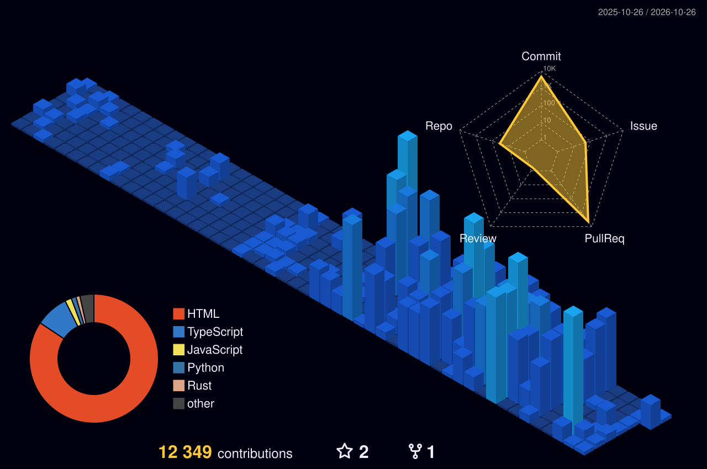

# I'm wyf027 👋

- 🛠️ **Yangfan Wu · Frontend / AI builder**
- 🌱 Exploring **AI workflows, model routing, and developer tools**
- 📍 Based in **Shenzhen, China**
- 💻 Building with **React, TypeScript, Next.js, and Node.js**
- 💬 Ask me about **frontend development, AI workflows, and Web3 interfaces**
- 🌐 Find my work at **[wyf027.github.io](https://wyf027.github.io/)**
- ⚡ **Less noise, more runtime.**

 

  

  <picture>
    <source media="(prefers-color-scheme: dark)" srcset="https://raw.githubusercontent.com/wyf027/wyf027/snake-output/github-contribution-grid-snake-dark.svg" />
    <source media="(prefers-color-scheme: light)" srcset="https://raw.githubusercontent.com/wyf027/wyf027/snake-output/github-contribution-grid-snake.svg" />
    
  </picture>

## 3D Contribution Calendar

  <picture>
    <source media="(prefers-color-scheme: dark)" srcset="./profile-3d-contrib/profile-night-view.svg" />
    <source media="(prefers-color-scheme: light)" srcset="./profile-3d-contrib/profile-green-animate.svg" />
    
  </picture>

<b>Selected projects</b>

| Project | What I'm building |
| --- | --- |
| [le-e](https://wyf-le-e.vercel.app/) | A terminal LeetCode workspace with editing, testing, and submission. [Source](https://github.com/wyf027/leetcode-solu/tree/main/project/le-e). |
| [leetcode-solu](https://github.com/wyf027/leetcode-solu) | LeetCode solutions, notes, and problem-solving patterns. |
| [react-ui-library](https://github.com/wyf027/react-ui-library) | Reusable React + TypeScript components. |
| [ai-api-gateway](https://github.com/wyf027/ai-api-gateway) | An API gateway for model routing, authentication, and usage control. |
| [w-swap-frontend](https://github.com/wyf027/w-swap-frontend) | A Web3 token swap frontend. |
| [w-stake-fe](https://github.com/wyf027/w-stake-fe) | A staking dashboard with React, TypeScript, and Web3 integrations. |

Layout inspired by <a href="https://github.com/jjyaoao">jjyaoao</a>.
