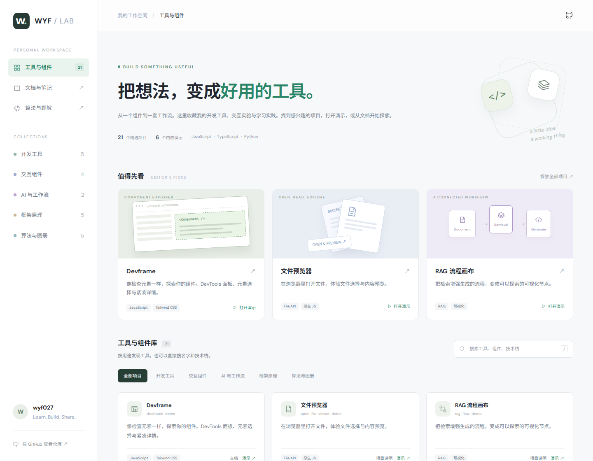

<div align="center">

# Yangfan Wu

**Frontend / AI builder**

`Less noise, more runtime.`

[](https://wyf027.github.io/)
[](https://github.com/wyf027)

</div>

## 工具与组件 · Toolbox

把想法，变成好用的工具。开发工具、交互组件和 AI 工作流，都在这里。

[](https://github.com/wyf027/leetcode-solu/tree/main/project)

<p align="center">
  <a href="https://github.com/wyf027/leetcode-solu/tree/main/project"><b>浏览项目源码 ↗</b></a>
  &nbsp; · &nbsp;
  <a href="https://wyf-leetcode-toolbox.sundean254.chatgpt.site/">交互网页预览 ↗（需访问权限）</a>
</p>

<table>
  <tr>
    <td width="50%"><a href="https://github.com/wyf027/leetcode-solu/tree/main/project/devframe-demo"><b>▣ Devframe</b></a><br/>像检查网页一样，探索组件。<br/><sub>开发工具 · DevTools 面板演示</sub></td>
    <td width="50%"><a href="https://github.com/wyf027/leetcode-solu/tree/main/project/open-file-viewer-demo"><b>▤ 文件预览器</b></a><br/>在浏览器里打开、查看文件。<br/><sub>文件工具 · File API</sub></td>
  </tr>
  <tr>
    <td><a href="https://github.com/wyf027/leetcode-solu/tree/main/project/rag-flow-demo"><b>◇ RAG 流程画布</b></a><br/>把 AI 查资料、生成回答的过程画出来。<br/><sub>AI 工作流 · 可视化演示</sub></td>
    <td><a href="https://github.com/wyf027/leetcode-solu/tree/main/project/screenshot-workflow-lite"><b>▧ 截图工作流</b></a><br/>用截图整理流程，生成流程描述。<br/><sub>AI 工作流 · 本地原型</sub></td>
  </tr>
  <tr>
    <td><a href="https://github.com/wyf027/leetcode-solu/tree/main/project/drag-sort"><b>↕ 拖拽排序</b></a><br/>拖动卡片，顺滑地调整顺序。<br/><sub>交互组件 · FLIP 动画</sub></td>
    <td><a href="https://github.com/wyf027/leetcode-solu/tree/main/project/mini-react"><b>⌘ Mini React</b></a><br/>从小实现开始，理解 React 原理。<br/><sub>框架学习 · 渲染与调度</sub></td>
  </tr>
</table>

```txt
profile@wyf027
role      Frontend / AI builder
runtime   React + TypeScript + Next.js + Node.js
focus     AI workflows, Web3 interfaces, developer tooling
style     clean UI, typed contracts, practical automation
location  Shenzhen, China
signal    Less noise, more runtime
```

## Control Panel

<table>
  <tr>
    <td><b>Interface Systems</b><br/>I build React and TypeScript interfaces with clear state, predictable data flow, and practical component boundaries.</td>
    <td><b>AI Workflows</b><br/>I explore API gateways, model routing, automation, and tools that turn repeated work into reliable workflows.</td>
  </tr>
  <tr>
    <td><b>Web3 Frontends</b><br/>I work on swap, staking, wallet connection, and dashboard experiences where product clarity matters.</td>
    <td><b>Developer Experience</b><br/>I care about readable code, typed contracts, useful docs, and shipping things that are easy to continue.</td>
  </tr>
</table>

## Stack

<p>
  
  
  
  
  
  
  
</p>

## Selected Work

| Project | Signal |
| --- | --- |
| [le-e](https://wyf-le-e.vercel.app/) | A terminal LeetCode workspace with Micro editing, testing, and submission. [Source & setup](https://github.com/wyf027/leetcode-solu/tree/main/project/le-e). |
| [leetcode-solu](https://github.com/wyf027/leetcode-solu) | LeetCode notes, patterns, and problem-solving practice. |
| [react-ui-library](https://github.com/wyf027/react-ui-library) | React + TypeScript component library experiments. |
| [ai-api-gateway](https://github.com/wyf027/ai-api-gateway) | Unified API gateway ideas for model routing, auth, and usage control. |
| [w-swap-frontend](https://github.com/wyf027/w-swap-frontend) | Web3 token swap frontend. |
| [w-stake-fe](https://github.com/wyf027/w-stake-fe) | Web3 staking dashboard frontend. |

## Metrics

| Signal | Current |
| --- | --- |
| Contribution rhythm | 3.6k+ contributions in the last year |
| Primary languages | TypeScript, HTML, JavaScript, Java |
| Public focus | UI systems, AI gateway ideas, Web3 product surfaces |
| Working mode | Build, test, document, iterate |

## Current Direction

- Build frontend systems that stay understandable as they grow.
- Turn AI APIs into useful, controlled product workflows.
- Keep the interface quiet, the types strict, and the runtime honest.

---

<div align="center">
  <sub>Code is how I leave fingerprints on the future.</sub>
</div>
