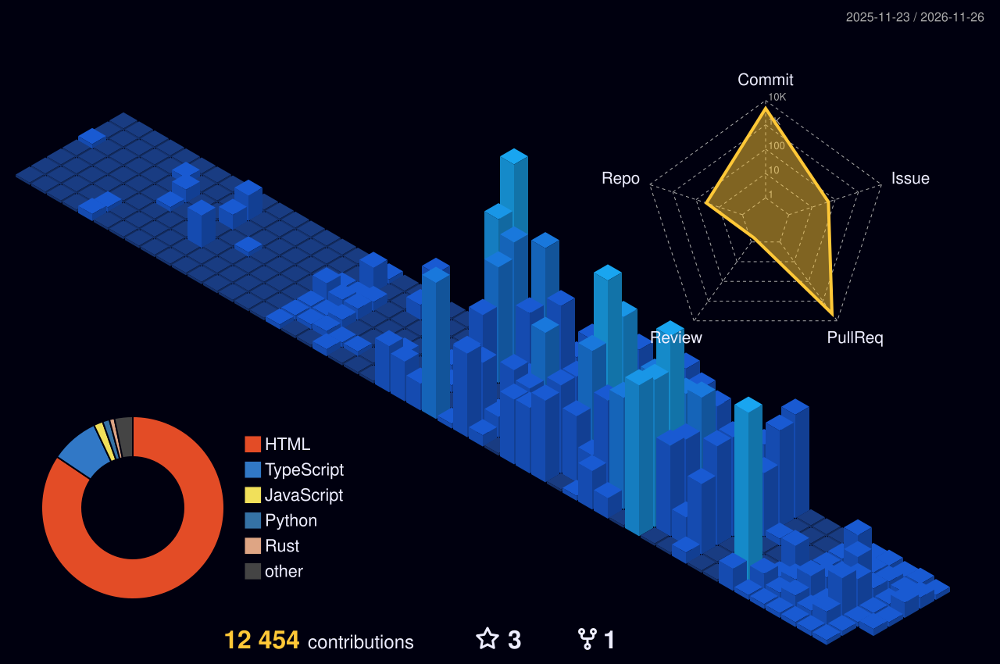

# I'm wyf027 👋

- 🛠️ **Yangfan Wu · Frontend / AI builder**
- 🌱 Exploring **AI workflows, model routing, and developer tools**
- 📍 Based in **Shenzhen, China**
- 💻 Building with **React, TypeScript, Next.js, and Node.js**
- 💬 Ask me about **frontend development, AI workflows, and Web3 interfaces**
- 🌐 Find my work at **[wyf027.github.io](https://wyf027.github.io/)**
- ⚡ **Less noise, more runtime.**

 

## Tools & Apps

### Developer Tools

- **[le-e](https://github.com/wyf027/leetcode-solu/tree/main/project/le-e)** — Browse LeetCode problems, edit solutions, run tests, and submit from a terminal workspace. [Web demo](https://wyf-le-e.vercel.app/)
- **[AI API Gateway](https://github.com/wyf027/ai-api-gateway)** — OpenAI-compatible gateway for model routing, API keys, and usage limits.
- **[Local Web Terminal](https://github.com/wyf027/leetcode-solu/pull/2259)** — Share one tmux session between the browser and your local terminal. *(PR open)*
- **[leno23-installer](https://github.com/wyf027/leno23-installer)** — Rust CLI that installs files from a GitHub archive without requiring Git.

### Frontend Libraries

- **[React UI Library](https://github.com/wyf027/react-ui-library)** — Reusable React and TypeScript components. [Component gallery](https://wyf027.github.io/react-ui-library/)
- **[Web3 Wallet SDK](https://github.com/wyf027/w-wallet-sdk)** — React hooks and components for connecting wallets and managing network and balance state. [Demo](https://w-web3-connector.vercel.app/)

### iOS Apps

- **Contest Reminder · 竞赛提醒** — Programming contest calendar and start reminders across five platforms. *(Private repository)*
- **QingJi · 轻记** — Personal expense tracking, shared family budgets, and a photo journal. *(Private repository)*

  

  <picture>
    <source media="(prefers-color-scheme: dark)" srcset="https://raw.githubusercontent.com/wyf027/wyf027/snake-output/github-contribution-grid-snake-dark.svg" />
    <source media="(prefers-color-scheme: light)" srcset="https://raw.githubusercontent.com/wyf027/wyf027/snake-output/github-contribution-grid-snake.svg" />
    
  </picture>

## 3D Contribution Calendar

  <picture>
    <source media="(prefers-color-scheme: dark)" srcset="./profile-3d-contrib/profile-night-view.svg" />
    <source media="(prefers-color-scheme: light)" srcset="./profile-3d-contrib/profile-green-animate.svg" />
    
  </picture>

<b>More projects</b>

| Project | What I'm building |
| --- | --- |
| [leetcode-solu](https://github.com/wyf027/leetcode-solu) | LeetCode solutions, notes, and problem-solving patterns. |
| [w-swap-frontend](https://github.com/wyf027/w-swap-frontend) | A Web3 token swap frontend. |
| [w-stake-fe](https://github.com/wyf027/w-stake-fe) | A staking dashboard with React, TypeScript, and Web3 integrations. |

Layout inspired by <a href="https://github.com/jjyaoao">jjyaoao</a>.
